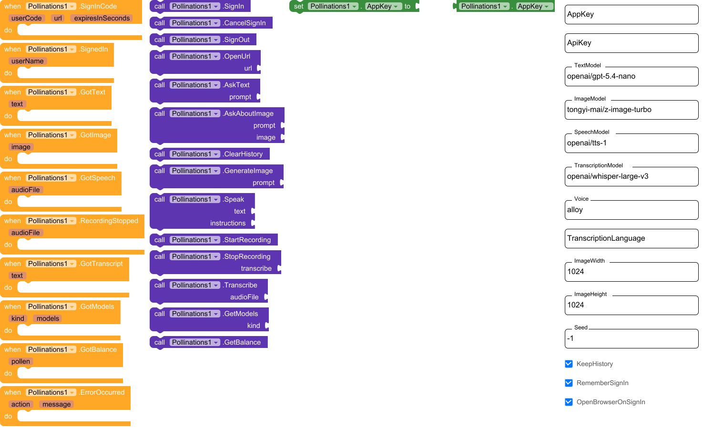

# Pollinations for Kodular

[](https://pollinations.ai/?ref=badge)

One non-visible extension that brings [Pollinations](https://pollinations.ai) to
[Kodular](https://www.kodular.io): chat, ask about a photo, make images, text-to-speech and
speech-to-text, all from blocks.

Your users sign in with **their own Pollen** through the
[Bring Your Own Pollen](https://github.com/pollinations/pollinations/blob/main/BRING_YOUR_OWN_POLLEN.md)
device flow. No API key ships inside your app, and your account is never charged for their use.

- **Download:** [`io.github.drjacky.pollinations.aix`](dist/io.github.drjacky.pollinations.aix)
- **Sample project:** [`PollinationsDemo.aia`](sample/PollinationsDemo.aia) (the extension is
  already inside it: Kodular Creator > My Projects > Import project)
- **Blocks:** [all blocks in one picture](docs/blocks.png)



## Built for Kodular

Some App Inventor extensions break in Kodular. This one is compiled for Kodular on purpose:

- Built with [FAST](https://github.com/jewelshkjony/FAST-CLI) with `target_platform: kodular`, so
  it is compiled against Kodular's own runtime classes, not App Inventor's.
- Uses only runtime classes that exist in both builders (`AndroidNonvisibleComponent`,
  `AsynchUtil`, `MediaUtil`, `PermissionResultHandler`, `YailList`) and plain
  `HttpURLConnection` + `org.json`. No extra libraries, no AndroidX, no Kotlin, so there is nothing
  to clash with Kodular's own copies.
- Permissions (`INTERNET`, `RECORD_AUDIO`) are declared in `src/AndroidManifest.xml`, the way
  Kodular reads them from `component_build_infos.json`, instead of App Inventor-only annotations.
- Non-visible, min SDK 14, `classes.jar` + D8 `AndroidRuntime.jar`, 49 KB.
- Every block call returns at once; the network work runs on a background thread and every result
  comes back as an event on the UI thread, so the screen never freezes.

The same `.aix` also imports into MIT App Inventor, Niotron and Android Builder.

## What it does

| You want | Blocks | Answer arrives in |
| --- | --- | --- |
| Sign the user in with their Pollen | `SignIn` | `SignInCode` (code + link), then `SignedIn` |
| Chat (remembers the conversation) | `AskText` | `GotText` |
| Ask about a picked or taken photo | `AskAboutImage` | `GotText` |
| Make an image | `GenerateImage` | `GotImage` (a file for `Image.Picture`) |
| Text to speech | `Speak` | `GotSpeech` (an mp3 for `Player.Source`) |
| Record and transcribe the microphone | `StartRecording`, `StopRecording` | `RecordingStopped`, `GotTranscript` |
| Transcribe any audio file | `Transcribe` | `GotTranscript` |
| Any model from the live lists | `GetModels` (text, vision, image, video, speech, transcription) | `GotModels` (a list for a List Picker) |
| Pollen left | `GetBalance` | `GotBalance` |
| Something failed | | `ErrorOccurred(action, message)` |

These are the things the built-in Web component cannot do well: a multipart upload of a
recording for speech-to-text, sending a picked photo to a vision model (the extension shrinks it
to 1024 px and sends it as JPEG), and the device-flow sign-in.

## Quick start

1. In Kodular Creator: **My Projects > Import project** and pick `PollinationsDemo.aia`.
   Or, for your own project, **Palette > Extensions > Import extension** and pick the `.aix`.
2. Drag **Pollinations** onto the screen.
3. Blocks:

```
when ButtonSignIn.Click          -> call Pollinations1.SignIn
when Pollinations1.SignInCode    -> set Label1.Text to join("Approve code ", userCode)
when Pollinations1.SignedIn      -> set Label1.Text to join("Hi ", userName)

when ButtonAsk.Click             -> call Pollinations1.AskText(TextBox1.Text)
when Pollinations1.GotText       -> set Label2.Text to text

when ButtonImage.Click           -> call Pollinations1.GenerateImage(TextBox1.Text)
when Pollinations1.GotImage      -> set Image1.Picture to image

when ImagePicker1.AfterPicking   -> call Pollinations1.AskAboutImage("What is this?", ImagePicker1.Selection)

when ButtonRecord.Click          -> call Pollinations1.StartRecording
when ButtonStop.Click            -> call Pollinations1.StopRecording(transcribe = true)
when Pollinations1.GotTranscript -> set TextBox1.Text to text

when Pollinations1.ErrorOccurred -> call Notifier1.ShowAlert(join(action, ": ", message))
```

`SignIn` opens `enter.pollinations.ai/device` in the browser with the code filled in. The user
signs in with GitHub, approves, and comes back to the app; `SignedIn` fires by itself. The key is
kept in the app's private storage (turn `RememberSignIn` off to keep it in memory only), and
`SignOut` forgets it. Keys last 7 days by default and users can revoke them any time in their
dashboard.

## Properties

| Property | Default | Notes |
| --- | --- | --- |
| `AppKey` | empty | Optional publishable `pk_` key from [enter.pollinations.ai](https://enter.pollinations.ai). It puts your app's name on the sign-in screen. Safe to ship: it can't spend Pollen. |
| `ApiKey` | empty | Optional `sk_` key **for your own testing only**. Anyone can pull it out of an APK, so leave it empty in shared apps and use `SignIn`. A signed-in user's key always wins. |
| `TextModel` | `openai/gpt-5.4-nano` | Used by `AskText` and `AskAboutImage` (it can see pictures). |
| `ImageModel` | `tongyi-mai/z-image-turbo` | |
| `SpeechModel` | `openai/tts-1` | |
| `Voice` | `alloy` | `alloy`, `echo`, `fable`, `onyx`, `nova`, `shimmer` for OpenAI TTS; other speech models have their own. |
| `TranscriptionModel` | `openai/whisper-large-v3` | |
| `TranscriptionLanguage` | empty (detect) | Two-letter code such as `en`, `de`, `fa`. |
| `SystemPrompt` | empty | Sent before every `AskText`. |
| `KeepHistory` | true | Follow-up questions remember the chat. `ClearHistory` starts over. Photos are not resent on later turns, so they don't cost Pollen again. |
| `ImageWidth`, `ImageHeight` | 1024 | |
| `Seed` | -1 | Same prompt + seed = same image. -1 means a new image each time. |
| `RememberSignIn` | true | |
| `OpenBrowserOnSignIn` | true | Turn off to show the link yourself (for example as a QR code for a TV or kiosk app). |
| `IsSignedIn`, `UserName`, `IsRecording` | read-only | |

Model names come from the live lists, so new models work without an extension update:
[text](https://gen.pollinations.ai/text/models), [image](https://gen.pollinations.ai/image/models),
[audio](https://gen.pollinations.ai/audio/models). Use `GetModels` to show them in a List Picker.

## Errors you may see

`ErrorOccurred` gives the failing block and a readable message:

- `401` before sign-in: "Sign in first (call SignIn)."
- `401` after sign-in: the key expired or was revoked, call `SignIn` again.
- `402`: the user is out of Pollen.
- `StopRecording` straight after `StartRecording`: "The recording was too short."

## Privacy

- The key is sent only in the `Authorization` header to `gen.pollinations.ai` and
  `enter.pollinations.ai`, never in a URL, so it can't leak through logs or image links.
- Generated images, speech and recordings are saved in the app's private cache and files older
  than a day are cleaned up.
- The extension asks for `INTERNET` and `RECORD_AUDIO` (the microphone prompt shows only when you
  call `StartRecording`).

## Build it yourself

Needs JDK 11 and [FAST-CLI](https://github.com/jewelshkjony/FAST-CLI) 7.3 (free edition).

```sh
git clone https://github.com/Drjacky/pollinations-kodular.git
cd pollinations-kodular
fast build -b                  # -> out/io.github.drjacky.pollinations.aix and block images
python3 tools/make_aia.py      # -> sample/PollinationsDemo.aia
./tools/test.sh                # unit tests against a local mock server (no network, no Pollen)
```

The HTTP code lives in plain Java (`src/io/github/drjacky/pollinations/client`), with no Android
imports, so it is tested on a normal JVM. `tools/LiveSmoke.java` runs the same client against the
real API with the cheapest models if you set `POLLINATIONS_KEY`.

## License

MIT. See [LICENSE](LICENSE).
